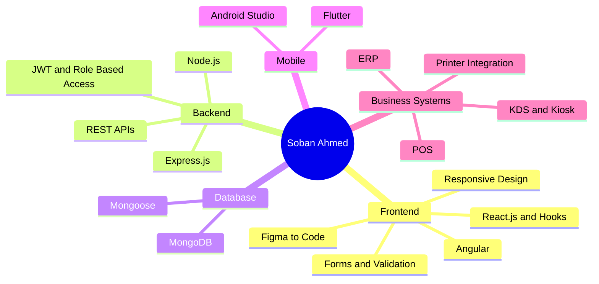
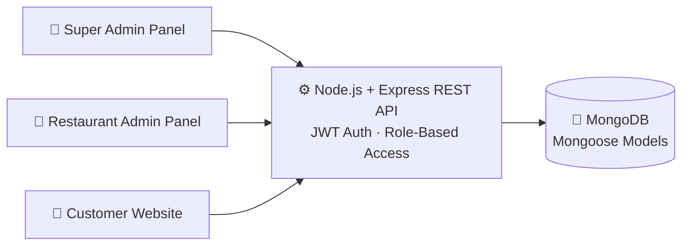
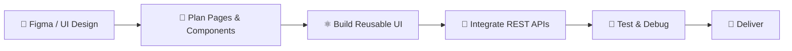
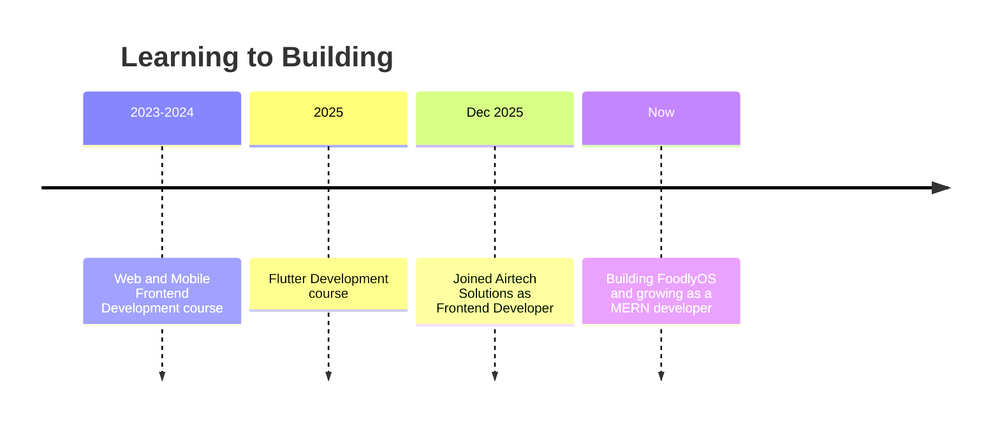

<a name="top"></a>
<div align="center">

<h1>👋 Soban Ahmed</h1>
<h3>MERN Stack Developer &nbsp;|&nbsp; Frontend Developer</h3>

<a href="https://github.com/SobanAhmed96">
  
</a>

<br/><br/>


<br/><br/>

<a href="https://www.linkedin.com/in/soban-ahmed-b50b30316/"></a>
<a href="mailto:sobanahmed9898@gmail.com"></a>
<a href="https://github.com/SobanAhmed96"></a>

<br/><br/>


<br/><br/>

**[About](#about) · [Skills](#skills) · [Projects](#projects) · [Experience](#experience) · [Services](#services) · [Stats](#stats) · [Contact](#contact)**

</div>

---

<a name="about"></a>
## 👨‍💻 About Me

```bash
soban@karachi:~$ whoami
Soban Ahmed

soban@karachi:~$ cat role.txt
MERN Stack Developer | Frontend Developer @ Airtech Solutions

soban@karachi:~$ ls skills/
react/  angular/  node/  express/  mongodb/  flutter/

soban@karachi:~$ echo $STATUS
Building FoodlyOS... open to opportunities 🚀
```

```js
const soban = {
  name: "Soban Ahmed",
  role: "MERN Stack Developer | Frontend Developer",
  currentJob: "Frontend Developer @ Airtech Solutions (Dec 2025 - Present)",
  location: "Karachi, Pakistan 🇵🇰",
  currentlyBuilding: "FoodlyOS - multi-role food delivery platform",
  stack: ["React.js", "Angular", "Node.js", "Express.js", "MongoDB", "Flutter"],
  strengths: ["Figma-to-Code", "REST APIs", "JWT Auth", "ERP / POS / KDS / Kiosk"],
  openTo: "Collaboration, freelance projects & new opportunities 🚀",
};
```

<table>
<tr>
<td width="50%">💻 Building complete web apps, <b>from database to user interface</b></td>
<td width="50%">🎨 Turning Figma designs into clean, responsive UIs</td>
</tr>
<tr>
<td>🧾 ERP, POS, KDS, Kiosk & Self-Checkout systems</td>
<td>🖨️ Printer integration for receipts, invoices & reports</td>
</tr>
<tr>
<td>🔐 REST APIs, JWT authentication & role-based access</td>
<td>📱 Flutter features, bug fixes & Android testing</td>
</tr>
<tr>
<td>🤖 AI-assisted development to build and debug faster</td>
<td>🎓 Planning university studies in Computer Science</td>
</tr>
</table>

### 🎯 Current Focus

| 🔭 Working on | 🌱 Improving | 🎓 Next goal |
|---|---|---|
| FoodlyOS, a full MERN food delivery product | Full-stack skills, clean architecture & reusable components | University studies in Computer Science |

---

<a name="skills"></a>
## 🧰 Tech Stack

<div align="center">

**Frontend**<br/>


**Backend & Database**<br/>


**Mobile**<br/>


**Tools**<br/>


**AI Tools I Work With**<br/>


</div>

### 🧠 Skill Map



<details>
<summary><b>📚 Full skill breakdown (click to expand)</b></summary>
<br/>

| Area | Skills |
|---|---|
| **Full Stack (MERN)** | MongoDB, Express.js, React.js, Node.js |
| **Languages** | JavaScript (ES6+), HTML5, CSS3, Dart |
| **Frontend** | React Hooks, Angular, Reusable Components, Responsive Design, Forms & Validation, REST API Integration |
| **Backend** | Node.js, Express.js, REST API Development, JWT Authentication, Role-Based Access |
| **Database** | MongoDB, Mongoose |
| **Mobile** | Flutter, Android Studio, Emulator Testing |
| **Business Systems** | ERP, POS, KDS, Kiosk, Self-Checkout, Printer Integration |
| **AI Tools** | Claude, ChatGPT, Gemini, DeepSeek, GLM, Kimi, Claude Code, GitHub Copilot, Qoder, Stitch, Lovable |

</details>

---

<a name="projects"></a>
## 🌟 Featured Projects

<table>
<tr>
<td width="50%" valign="top">

### 🍔 FoodlyOS &nbsp;`In Development`
**Multi-Role Food Delivery Platform**

`MongoDB` `Express.js` `React.js` `Node.js` `Mongoose` `JWT`

- 👑 **Super Admin**: platform control & restaurant oversight
- 🏪 **Restaurant Admin**: menu & incoming orders
- 🛒 **Customer Website**: browse, order, delivery
- 🔐 JWT auth with role-based access

</td>
<td width="50%" valign="top">

### 🚚 FoodCarrier
**Food Delivery Platform**

`React.js` `JavaScript` `REST APIs` `Git`

- Customer frontend with menu browsing & order flow
- Reusable components & responsive layouts
- REST API integration with error handling
- Admin interfaces & configurable delivery options

</td>
</tr>
<tr>
<td width="50%" valign="top">

### 📋 Digital Menu
**Digital Menu Application**

`React.js` `Responsive Design`

- Built the interface and responsive layout
- Clean UX across all screen sizes

</td>
<td width="50%" valign="top">

### 💼 Work @ Airtech Solutions
**Real business projects**

`React` `Angular` `Flutter`

- ERP admin panels & dashboards
- Angular POS system (billing & orders)
- KDS, Kiosk & Self-Checkout screens
- Printer integration for receipts & invoices

</td>
</tr>
</table>

### 🏗️ FoodlyOS Architecture



### 🔄 How I Build



---

<a name="experience"></a>
## 💼 Experience

```text
🏢 Frontend Developer - Airtech Solutions            Dec 2025 - Present
   Karachi, Pakistan
   ├── React.js apps from scratch (planning -> components -> implementation)
   ├── Figma/UI designs -> responsive interfaces (desktop, tablet, mobile)
   ├── REST API integration with loading & error states
   ├── Forms with controlled inputs & validation (useState, useEffect)
   ├── ERP admin panels, dashboards & business workflows
   ├── Angular POS system: billing & day-to-day order operations
   ├── KDS, Kiosk & Self-Checkout projects
   ├── Printer integration: receipts, invoices & reports
   ├── Flutter features, bug fixes & Android device/emulator testing
   └── Git/GitHub collaboration with backend devs, designers & QA
```

### 🛣️ My Journey



---

<a name="services"></a>
## 🤝 What I Can Build For You

<table>
<tr>
<td align="center" width="25%">🌐<br/><b>Web Apps</b><br/><sub>React.js & Angular applications built from scratch</sub></td>
<td align="center" width="25%">📊<br/><b>Admin Panels</b><br/><sub>Dashboards, ERP screens & business workflows</sub></td>
<td align="center" width="25%">🧾<br/><b>POS / KDS / Kiosk</b><br/><sub>Order, billing, checkout & receipt printing UIs</sub></td>
<td align="center" width="25%">⚙️<br/><b>MERN Products</b><br/><sub>Full-stack apps with REST APIs, JWT & role-based access</sub></td>
</tr>
</table>

<div align="center">

<a href="mailto:sobanahmed9898@gmail.com?subject=Project%20Inquiry">
  
</a>

</div>

---

<a name="stats"></a>
## 📊 GitHub Stats

<div align="center">


<br/><br/>


</div>

<!--
=====================================================================
OPTIONAL (enable ONLY after both workflows show a green tick in the
Actions tab). Delete this line and the closing line below to enable.
=====================================================================

<div align="center">


<br/><br/>

<picture>
  <source media="(prefers-color-scheme: dark)" srcset="https://raw.githubusercontent.com/SobanAhmed96/SobanAhmed96/output/github-snake-dark.svg" />
  <source media="(prefers-color-scheme: light)" srcset="https://raw.githubusercontent.com/SobanAhmed96/SobanAhmed96/output/github-snake.svg" />
  
</picture>

</div>

=====================================================================
-->

---

<a name="contact"></a>
## 📬 Let's Connect

<div align="center">

| Platform | Link |
|---|---|
| 💼 LinkedIn | [Soban Ahmed](https://www.linkedin.com/in/soban-ahmed-b50b30316/) |
| 💻 GitHub | [SobanAhmed96](https://github.com/SobanAhmed96) |
| 📧 Email | sobanahmed9898@gmail.com |
| 📍 Location | Karachi, Pakistan |

**💡 Open to collaboration, freelance projects & new opportunities!**


<a href="#top">⬆️ Back to top</a>

</div>
