

[](./assets/hero.svg)

  

    

**[About](#about) · [How I Build](#how-i-build) · [Projects](#projects) · [Experience](#experience) · [Services](#services) · [Stack](#stack) · [Activity](#activity) · [Contact](#contact)**

[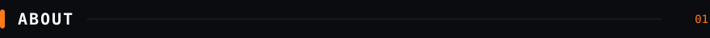](./assets/section-about.svg)

I build web products across the whole stack: **React and Angular frontends**, **Node/Express REST APIs with JWT auth**, and **MongoDB** data layers. At work I ship **ERP, POS, KDS, Kiosk and Self-Checkout** interfaces with printer integration, and I use **AI-assisted development** to build and debug faster.

[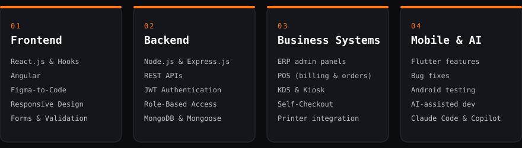](./assets/about.svg)

| 🔭 Working on | 🌱 Improving | 🎓 Next goal |
|---|---|---|
| FoodlyOS, a full MERN food delivery product | Full-stack skills, clean architecture & reusable components | University studies in Computer Science |

One workflow, six stages. Every project goes through the same path.

[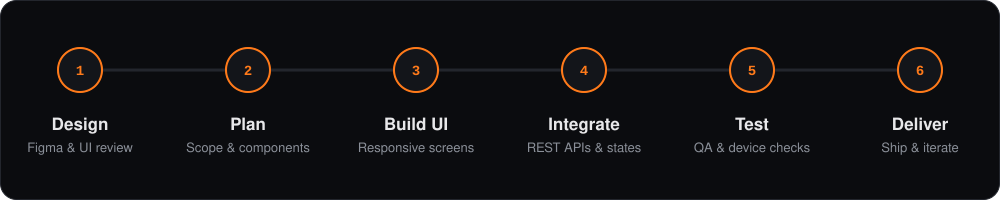](./assets/pipeline.svg)

#### 🍔 FoodlyOS &nbsp;`In Development`

**Multi-role food delivery platform** built on the full MERN stack with JWT authentication and role-based access.

[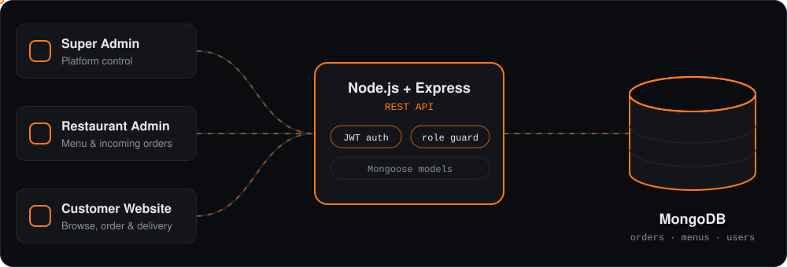](./assets/foodlyos-architecture.svg)

| Role | What it does |
|---|---|
| 👑 **Super Admin** | Platform control and restaurant oversight |
| 🏪 **Restaurant Admin** | Menu management and incoming orders |
| 🛒 **Customer Website** | Browse, order and delivery |

`MongoDB` `Express.js` `React.js` `Node.js` `Mongoose` `JWT`

#### More projects

| Project | Description | Stack |
|---|---|---|
| **🚚 FoodCarrier** | Food delivery platform: customer frontend with menu browsing & order flow, reusable components, responsive layouts, REST API integration with error handling, admin interfaces & configurable delivery options | `React.js` `JavaScript` `REST APIs` `Git` |
| **📋 Digital Menu** | Digital menu application with a clean interface and responsive layout across all screen sizes | `React.js` `Responsive Design` |
| **💼 Airtech Solutions** | Real business projects: ERP admin panels & dashboards, Angular POS system (billing & orders), KDS, Kiosk & Self-Checkout screens, printer integration for receipts & invoices | `React` `Angular` `Flutter` |

[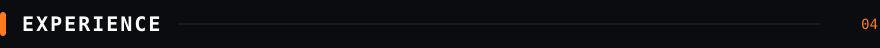](./assets/section-experience.svg)

#### 🏢 Frontend Developer — Airtech Solutions

`Dec 2025 – Present` · Karachi, Pakistan

- React.js apps from scratch: planning → components → implementation
- Figma/UI designs → responsive interfaces for desktop, tablet and mobile
- REST API integration with loading & error states
- Forms with controlled inputs & validation (`useState`, `useEffect`)
- ERP admin panels, dashboards & business workflows
- Angular POS system for billing & day-to-day order operations
- KDS, Kiosk & Self-Checkout projects
- Printer integration for receipts, invoices & reports
- Flutter features, bug fixes & Android device/emulator testing
- Git/GitHub collaboration with backend developers, designers & QA

#### 🛣️ Journey

| When | Milestone |
|---|---|
| **2023 – 2024** | Web and Mobile Frontend Development course |
| **2025** | Flutter Development course |
| **Dec 2025** | Joined Airtech Solutions as Frontend Developer |
| **Now** | Building FoodlyOS and growing as a MERN developer |

[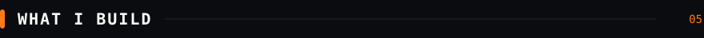](./assets/section-services.svg)

| 🌐 Web Apps | 📊 Admin Panels | 🧾 POS / KDS / Kiosk | ⚙️ MERN Products |
|---|---|---|---|
| React.js & Angular applications built from scratch | Dashboards, ERP screens & business workflows | Order, billing, checkout & receipt printing UIs | Full-stack apps with REST APIs, JWT & role-based access |

[](./assets/stack.svg)

 

[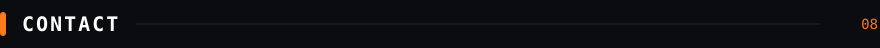](./assets/section-contact.svg)

[](mailto:sobanahmed9898@gmail.com)

  

[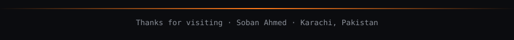](./assets/footer.svg)

<a href="#top">⬆️ Back to top</a>

